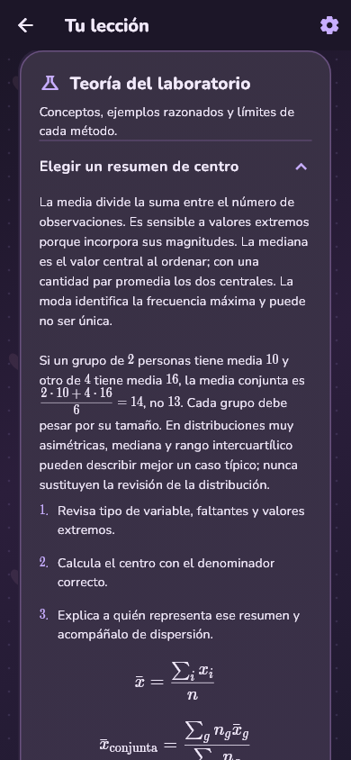
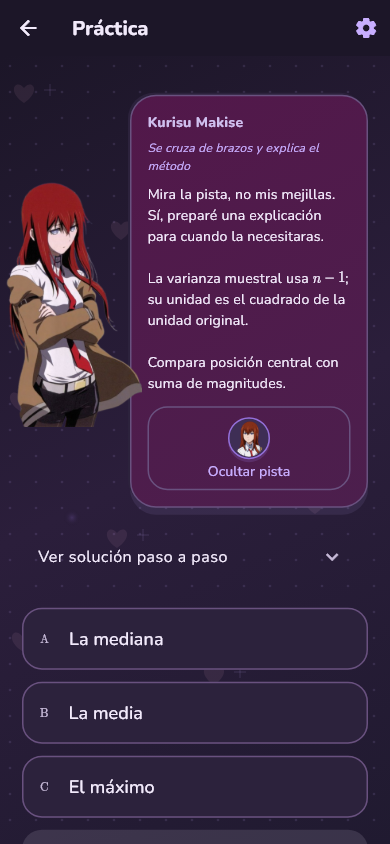

# Lumar Academy ♡

Tu campus anime para aprender matemáticas, lógica, física y ciencia de datos con teoría, tutoras con personalidad y ejercicios paso a paso.

**[Descargar para Android · 1.0.1-preview.2](https://github.com/Lumarri/lumar-academy-releases/releases/tag/v1.0.1-preview.2)**

Abre **Assets** y descarga `Lumar-Academy-v1.0.1-preview.2.apk`. Es una versión de prueba compilada en modo release. El código fuente se mantiene privado; los ZIP/TAR de «Source code» contienen solo esta presentación y sus capturas.

  
  
  

**13 cursos · 109 etapas · 2870 ejercicios** con teoría, ejemplos resueltos, pistas, explicaciones de errores y progreso guardado en tu dispositivo.

Álgebra, geometría, trigonometría, logaritmos y potencias, ecuaciones de segundo grado, precálculo, álgebra lineal, lógica, cálculo, física clásica introductoria, Física 1 universitaria y ciencia de datos.

## Nuevo: el laboratorio de Kurisu

**Ciencia de Datos** está disponible exclusivamente con **Kurisu Makise**: 12 etapas, 240 retos, estadística, probabilidad, modelos y evaluación. Sus diálogos originales rotan con referencias a Steins;Gate, pistas concretas y despedidas de etapa. Elige a Kurisu y abre el filtro **Datos**; cambiar de tutora conserva tus avances.

  
  
  

## El club de tutoras

| Tutora | Su invitación |
| --- | --- |
| Kurisu Makise | «Okabe puede inventar nombres y Daru preparar herramientas; tú y yo haremos preguntas, revisaremos evidencia y reconoceremos incertidumbre.» |
| Yuno Gasai | «Esta página necesita buenas razones, no una predicción afortunada. ♡» |
| Kotoko Ijichi | «¡Takuya y Kei, próximo episodio: ideas que toman forma!» |
| Hakari Hanazono | «Mi estrategia empieza por escuchar tus preguntas. ♡» |
| Karane Inda | «¡Una base firme y ningún signo perdido! Sí, te acompaño.» |
| Itsuki Nakano | «Quiero enseñar como mi madre: primero unas bases claras.» |

Frases originales de la adaptación educativa de Lumar Academy. Los personajes aparecen sobre la interfaz con las imágenes aportadas por su creador.

También encontrarás búsqueda y filtros de cursos, fórmulas LaTeX, modos claro y violeta oscuro pastel, ajustes de movimiento, repaso de lo que te cuesta y un cuaderno de curiosidades con lecturas recomendadas.

## Próximamente

Más tutoras, expresiones y cursos, incluyendo **programación** y **mecánica cuántica**, además de nuevas materias de matemáticas y física.

Las novedades y descargas se publican en [Releases](https://github.com/Lumarri/lumar-academy-releases/releases). Puedes instalar la APK sobre la versión anterior conservando sus datos; desinstalar la app o borrar sus datos elimina el progreso local. Todavía no hay descarga para iOS.
