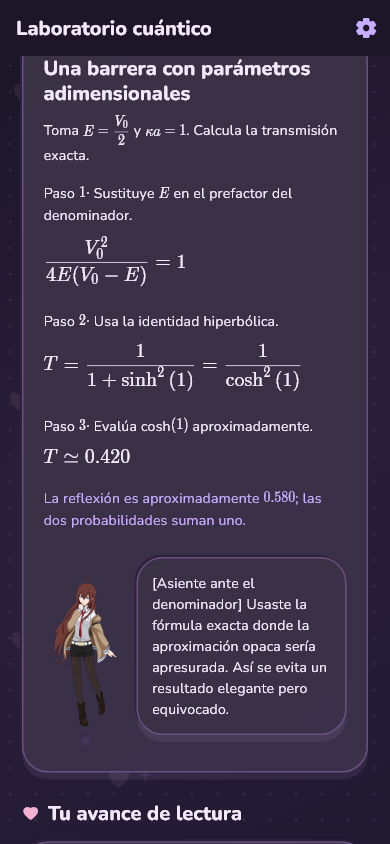

# Lumar Academy ♡

Tu academia anime para aprender matemáticas, física y computación con tutoras, teoría y ejercicios paso a paso.

**[Descargar para Android · 1.0.2-preview.3](https://github.com/Lumarri/lumar-academy-releases/releases/tag/v1.0.2-preview.3)**

En **Assets**, descarga `Lumar-Academy-v1.0.2-preview.3.apk`. `SHA256SUMS.txt` permite verificar el archivo. Es una versión de prueba; el código de la app permanece privado. Los ZIP/TAR de «Source code» contienen solo esta presentación y las capturas.

  
  
  

**17 cursos · 165 etapas · 4230 ejercicios**, más 36 ejemplos de mecánica cuántica. Fórmulas LaTeX, pistas, explicación de errores y progreso guardado en tu dispositivo.

Desde álgebra, geometría y trigonometría hasta cálculo, álgebra lineal, Física 1 y 2, ciencia de datos y ciencias de la computación. Las materias exclusivas tienen su propia tutora: Kurisu en datos y cuántica, Itsuki en computación y Karane en aritmética de olimpiada.

## El club de tutoras

| Tutora | Su invitación |
| --- | --- |
| Kurisu Makise | «Abramos Álgebra. Una buena pregunta y un método claro; el discurso de Okabe puede esperar.» |
| Yuno Gasai | «Esta página necesita buenas razones, no una predicción afortunada. ♡» |
| Kotoko Ijichi | «¡Takuya y Kei, próximo episodio: ideas que toman forma!» |
| Hakari Hanazono | «Mi estrategia empieza por escuchar tus preguntas. ♡» |
| Karane Inda | «¡Una base firme y ningún signo perdido! Sí, te acompaño.» |
| Itsuki Nakano | «Quiero enseñar como mi madre: primero unas bases claras.» |
| Rukia Kuchiki | «Ichigo no aprendió todo de golpe; tú tampoco necesitas saltarte la introducción para impresionarme.» |

Diálogos originales de la adaptación educativa. **Urumi Kanzaki** acompaña exclusivamente Filosofía en el Cuaderno.

Inicio, Cursos, Cuaderno y Perfil organizan la academia. Encontrarás rutas de estudio, repaso, música, ajustes de lectura, respaldos locales y un Cuaderno con 50 curiosidades, 19 lecturas de teorías y análisis y 14 documentos de filosofía. Toda la interfaz usa violeta oscuro pastel.

Al final de Inicio, una invitada tiene 90 frases bromistas y reflexivas que cambian al abrir la app o regresar. Sí: también pregunta si ya comiste.

## Próximamente

Más tutoras, expresiones y cursos de matemáticas, física y programación. Las novedades aparecerán en [Releases](https://github.com/Lumarri/lumar-academy-releases/releases).

Puedes actualizar instalando la APK sobre la anterior. Desinstalar la app o borrar sus datos elimina el progreso local. Todavía no hay descarga para iOS.
