# Lumar Academy ♡

Tu academia anime para aprender matemáticas, física, computación e idiomas con tutoras, teoría y ejercicios paso a paso.

**[Descargar para Android · Versión 1.7.0](https://github.com/Lumarri/lumar-academy-releases/releases/tag/v1.7.0)**

En **Assets**, descarga `Lumar-Academy-v1.7.0.apk`. `SHA256SUMS.txt` permite verificar el archivo. El código de la app permanece privado. Los ZIP/TAR de «Source code» contienen solo esta presentación y las capturas.

  
  
  

**28 cursos · 373 etapas · 8390 ejercicios**, más ejemplos resueltos y 208 lecturas de idiomas. Fórmulas LaTeX, pistas, explicación de errores y progreso guardado en tu dispositivo.

**Nuevo en 1.7.0 · Tu sala de exámenes:** **34 pruebas y 716 preguntas** en **Cursos → Exámenes**. Elige entre Admisión, Cursos universitarios y Cursos de Lumar. Los 28 cursos tienen su propio integrador, con preguntas de todas sus etapas, búsqueda y sus tutoras exclusivas; Urumi supervisa Teología.

El reloj es obligatorio y continúa al salir. Puedes cambiar respuestas, marcar preguntas y pedir pistas; al entregar solo aparecen la nota y los aciertos por tema, sin mostrar las respuestas correctas. El historial se incluye en tus respaldos y conserva el progreso de los cursos por separado. Hay 20 preguntas por integrador, salvo Cuántica (24), Inglés hasta B2 (56) y Japonés (32) para cubrir todas sus etapas.

**Kurisu:** «El botón no es una máquina del tiempo: no devolverá los minutos.» **Karane:** «¡Soy tu tutora, no una alternativa marcada!» **Urumi:** «La eternidad es un tema del seminario; este cronómetro no la incluye.»

  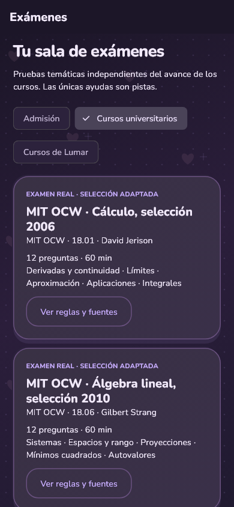
  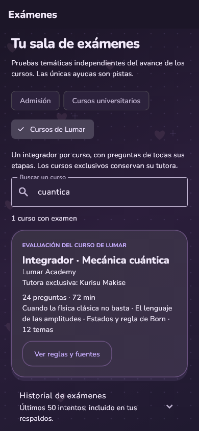
  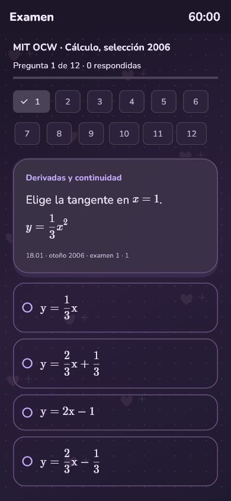
  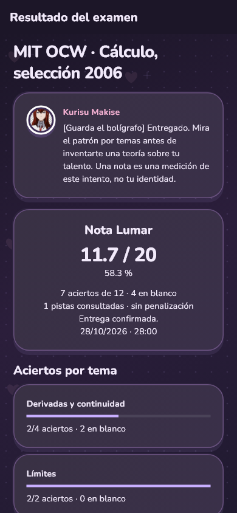

Los simulacros orientados a UNI y UNAM son originales de Lumar. Las dos selecciones de MIT OCW —18.01 de David Jerison, 2006, y 18.06 de Gilbert Strang, 2010— identifican fuentes y adaptaciones y se distribuyen bajo [CC BY-NC-SA 4.0](https://creativecommons.org/licenses/by-nc-sa/4.0/), con bancos legibles y créditos en la APK. Son referencias educativas; no hay afiliación ni calificación universitaria oficial. Los controles y comentarios son bilingües; las preguntas y pistas se presentan en español, con lecturas en el idioma estudiado.

**Disponible desde 1.6.0 · El azar y las partículas:** Probabilidad, exclusiva de Yuno, y Física de partículas, exclusiva de Kurisu. **18 etapas y 360 ejercicios por curso**, con dificultad creciente, teoría universitaria gradual, 108 ejemplos resueltos y 174 textos propios de las tutoras. Pistas y soluciones explican el razonamiento y los errores, con fuentes de MIT, Harvard, CERN, ATLAS, OpenStax y PDG.

**Yuno:** «Una alarma no es una sentencia del Diario del Futuro. Veamos cuántas historias distintas pudieron activar la misma señal.» Su recorrido comienza con eventos y conteo, llega a Bayes y distribuciones y avanza a cadenas de Markov y Monte Carlo.

**Kurisu:** «La palabra “cuántico” no vuelve profundo un botón. Especifica el estado y la medición; después sí podemos hablar de probabilidades.» Enseña las bases necesarias de relatividad y cuántica antes de entrar en partículas, interacciones, detectores, neutrinos, Higgs y evidencia experimental.

**Seis experimentos sin conexión:** Bayes y alarmas, frecuencias simuladas, cadenas de Markov, masa invariante de dos fotones, momento transversal y decaimiento relativista. Puedes modificar los parámetros y observar el resultado; las simulaciones explican sus límites y no conceden progreso académico.

  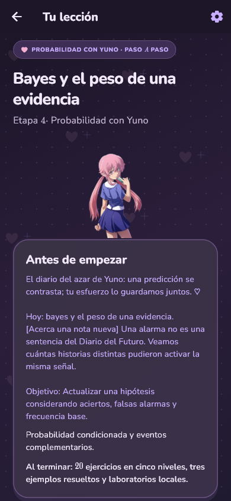
  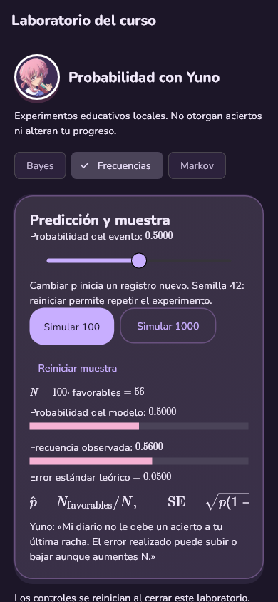
  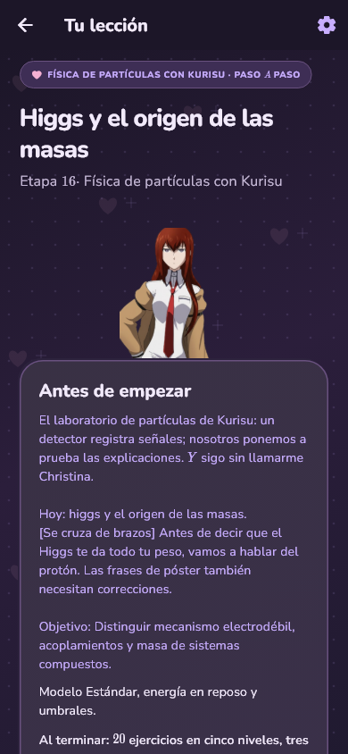
  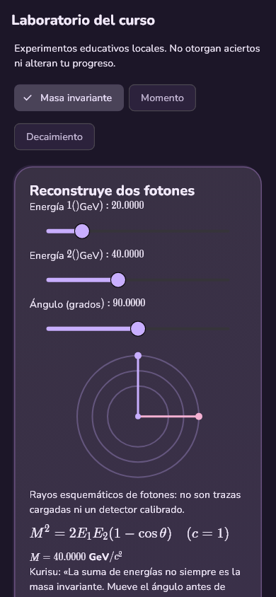

**Disponible desde 1.5.0 · El seminario de Urumi:** Teología cristiana con 14 etapas y 280 actividades. Lecturas extensas, fuentes primarias, historia, hermenéutica, debates y un diario para tu interpretación. Compara tradiciones cristianas y distingue doctrina, filosofía, historia y ciencia. Las actividades evalúan la comprensión de argumentos; tus creencias personales no se califican.

Urumi conserva su orgullo, ironía, referencias a GTO y comentarios de cuarta pared: «[Sonríe con orgullo] Onizuka improvisaría. Yo preparé una distinción que merece treinta segundos de atención.» Es la anfitriona fija de este curso y conserva tu selección habitual para las demás materias.

  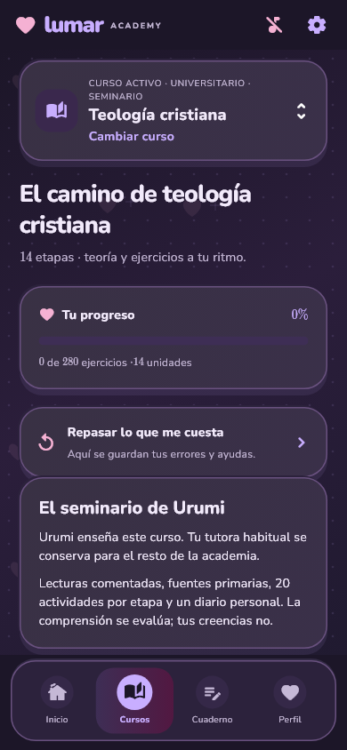
  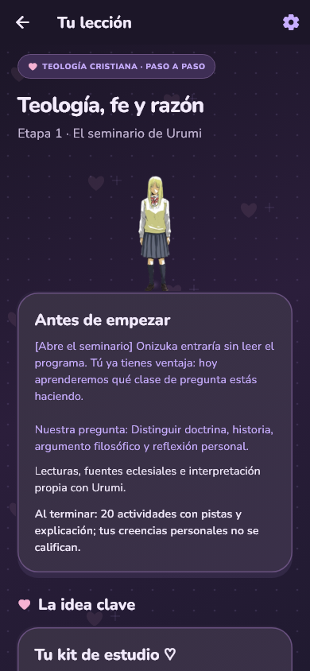
  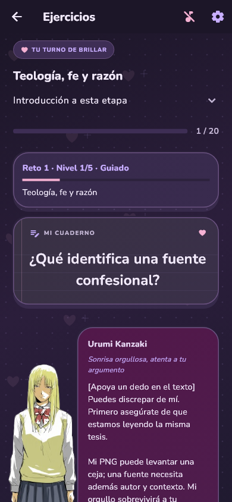

La actualización corrige el guardado de reflexiones con emojis y los avisos de éxito cuando una escritura falla. Los respaldos admiten hasta 16 MiB para conservar historiales y notas extensas. También prepara el proyecto para iOS 15+, pero la descarga disponible sigue siendo Android: todavía faltan compilación, firma y pruebas de iPhone.

Desde álgebra, geometría y trigonometría hasta cálculo, álgebra lineal, Física 1 y 2, ciencia de datos y ciencias de la computación. Las materias exclusivas tienen su propia tutora: Kurisu en datos y cuántica, Itsuki en computación y Karane en aritmética de olimpiada.

**También disponibles desde 1.4.0 · Seis aulas exclusivas:**

| Curso | Tutora | Etapas | Ejercicios |
| --- | --- | ---: | ---: |
| Inglés C1 | Karane Inda | 16 | 320 |
| Ingeniería de IA: LLM y agentes | Rukia Kuchiki | 12 | 240 |
| Matemática discreta | Yuno Gasai | 12 | 240 |
| Métodos numéricos | Itsuki Nakano | 10 | 200 |
| Sumatorias | Kotoko Ijichi | 8 | 160 |
| Ecuaciones diferenciales | Kurisu Makise | 12 | 240 |

**C1 con Karane** continúa desde B2 con 32 lecturas, 16 trabajos escritos, modelos, guardado y revisión propia. Al finalizar puedes exportar un certificado interno en PDF con anexo. Es una constancia de Lumar, no una acreditación oficial de nivel C1.

**IA con Rukia** enseña instrucciones, contexto, JSON, RAG, herramientas, agentes y evaluación mediante teoría y simulaciones locales, sin claves ni servicios de pago. **Las nuevas matemáticas** añaden laboratorios de grafos, bisección/Newton, sumatorias y Euler frente a una solución exacta. Ecuaciones diferenciales comienza con las herramientas de cálculo y avanza a Laplace y sistemas intermedios. Cada curso tiene diálogos propios, humor y referencias de su tutora.

  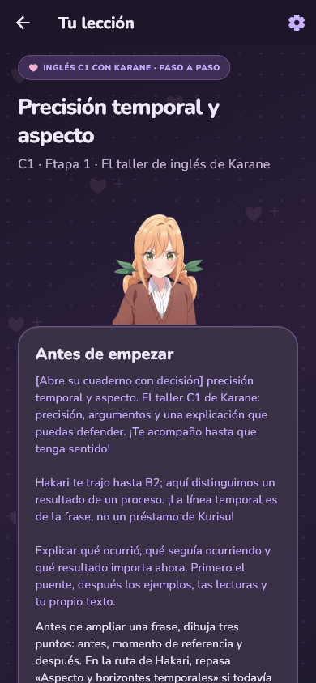
  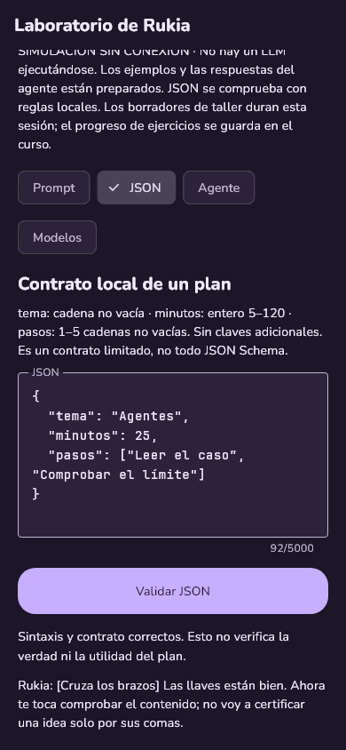
  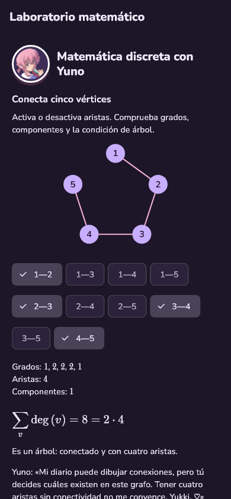
  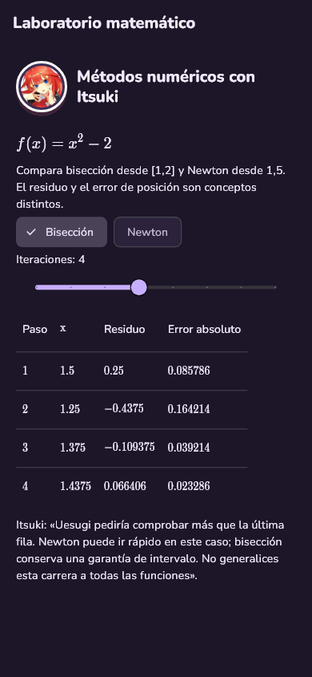
  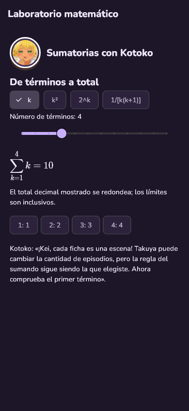
  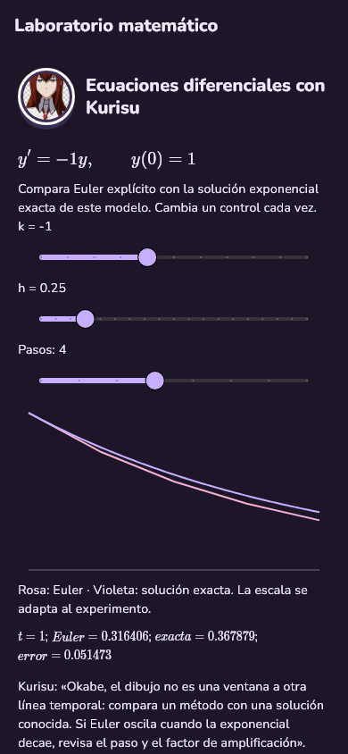

**Cuaderno:** ocho métodos de estudio con ejemplos y fuentes, 91 intervenciones de las tutoras y herramientas para organizar tus sesiones. Guarda objetivos, intentos y correcciones; usa el temporizador opcional de enfoque/descanso y programa hasta 40 preguntas con tus propias referencias y fechas editables. Todo funciona localmente y se incluye en los respaldos. Las autoevaluaciones son tuyas; el reloj no concede progreso académico.

**Becas y oportunidades:** 30 programas internacionales de Asia, Europa y América, para pregrado, maestría, doctorado y estancias de investigación. Filtros, favoritos, universidades, requisitos de nacionalidad y residencia, financiación, guía de preparación y fuentes oficiales. Catálogo consultable sin conexión, revisado el 17 de octubre de 2026; comprueba las bases vigentes antes de postular. Kurisu también tiene una nueva despedida sobre el potencial del futuro.

  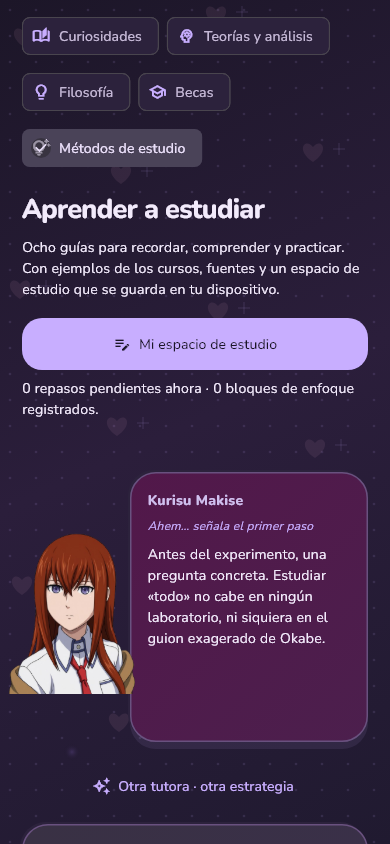
  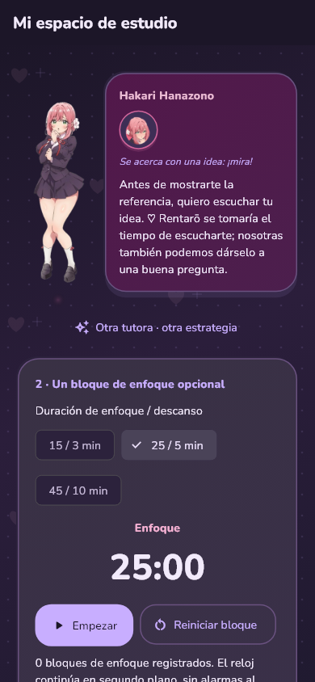
  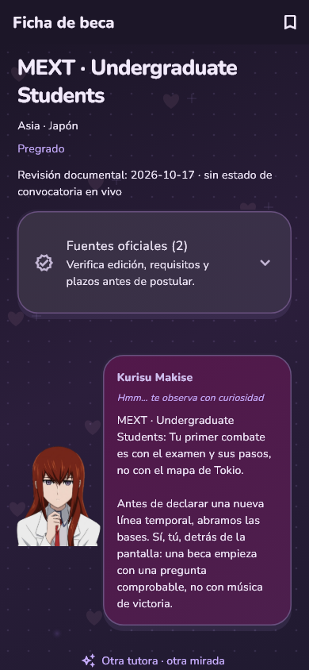

Inglés desde cero hasta B2 con Hakari (56 etapas, 1120 ejercicios y 112 lecturas) y Japonés desde cero hacia N5 con Kotoko (32 etapas, 640 ejercicios y 64 lecturas). Teoría explicada, frases que construyes con fichas, pistas y dificultad gradual. El japonés incluye botones de audio con voz del teléfono, modo lento/normal y música atenuada mientras habla. Una voz japonesa instalada permite usarlo sin conexión; no califica pronunciación ni expide certificación JLPT.

En **Ajustes → Idioma de la aplicación**, elige **Español / English** conservando tu avance. La interfaz, los comentarios de Inicio y Álgebra, Geometría y Trigonometría tienen inglés revisado: 19 etapas y 380 ejercicios con teoría, pistas, errores y diálogos de las siete tutoras. Becas y Métodos de estudio también están completos en ambos idiomas. Los cursos nuevos tienen controles bilingües, pero sus explicaciones y diálogos educativos conservan español; Inglés C1 usa lecturas y trabajos en inglés con apoyo. Las demás lecciones, artículos y el guion de la novela visual mantienen su contenido español hasta los próximos bloques de traducción.

## El club de tutoras

| Tutora | Su invitación |
| --- | --- |
| Kurisu Makise | «Abramos Álgebra. Una buena pregunta y un método claro; el discurso de Okabe puede esperar.» |
| Yuno Gasai | «Esta página necesita buenas razones, no una predicción afortunada. ♡» |
| Kotoko Ijichi | «¡Takuya y Kei, próximo episodio: ideas que toman forma!» |
| Hakari Hanazono | «Mi estrategia empieza por escuchar tus preguntas. ♡» |
| Karane Inda | «¡Una base firme y ningún signo perdido! Sí, te acompaño.» |
| Itsuki Nakano | «Quiero enseñar como mi madre: primero unas bases claras.» |
| Rukia Kuchiki | «Ichigo no aprendió todo de golpe; tú tampoco necesitas saltarte la introducción para impresionarme.» |

Diálogos originales de la adaptación educativa. **Urumi Kanzaki** acompaña Filosofía en el Cuaderno y es la anfitriona fija del nuevo curso de Teología.

Inicio, Cursos, Cuaderno y Perfil organizan la academia. Encontrarás rutas de estudio, repaso, música, ajustes de lectura, respaldos locales y un Cuaderno con 50 curiosidades, 19 lecturas de teorías y análisis, 14 documentos de filosofía, 30 becas y ocho guías de estudio. Toda la interfaz usa violeta oscuro pastel.

Al final de Inicio, una invitada tiene 90 frases bromistas y reflexivas que cambian al abrir la app o regresar. Sí: también pregunta si ya comiste.

## Una historia para resolver contigo

**El laboratorio a oscuras**, una novela visual con Kurisu en **Inicio → Descubrir**: 104 escenas, 14 momentos de elección, 39 opciones y siete retos con pistas y soluciones. Mayuri aparece de visita; tus respuestas reciben bromas y comentarios propios. Investiga una avería, aprende a modelar un circuito con ecuaciones diferenciales y llega a un final abierto. La partida se guarda por separado del progreso de los cursos.

  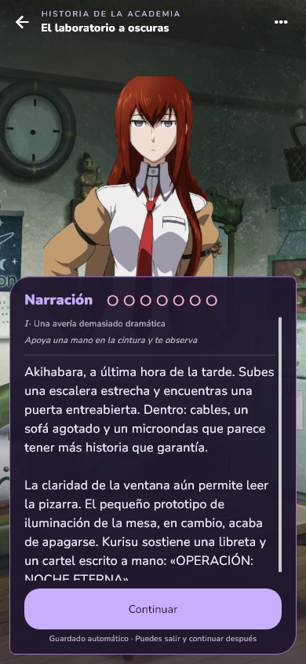
  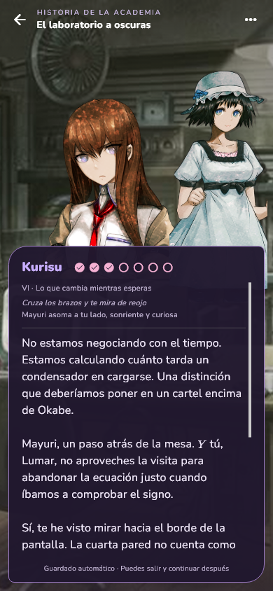
  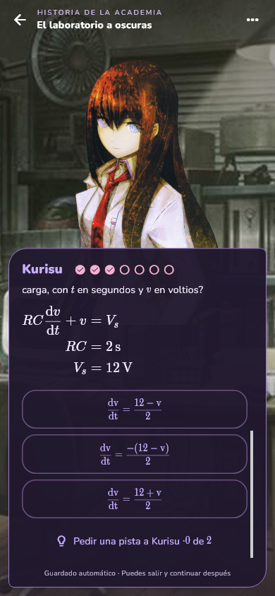

Las fórmulas, respuestas, pistas y pasos utilizan tipografía LaTeX. Las conversaciones son originales de esta adaptación educativa; no es un episodio oficial de STEINS;GATE.

## Próximamente

Más tutoras, expresiones y cursos de matemáticas, física y programación. Las novedades aparecerán en [Releases](https://github.com/Lumarri/lumar-academy-releases/releases).

Puedes actualizar instalando la APK sobre la anterior. Desinstalar la app o borrar sus datos elimina el progreso local. Todavía no hay descarga para iOS.
